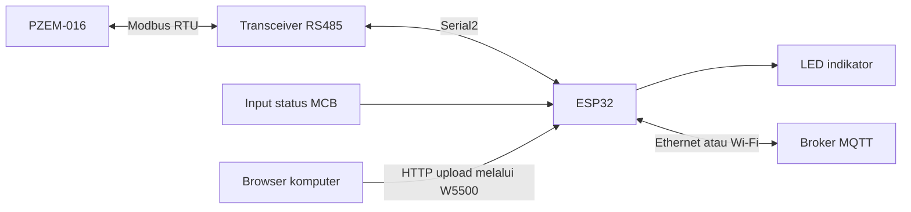

# Power Meter PZEM-016 — ESP32, MQTT, dan Ethernet OTA

Firmware ESP32 untuk membaca parameter listrik dari PZEM-016 melalui Modbus RTU/RS485, membaca status input MCB, dan mengirim data ke MQTT.

Firmware mendukung pemilihan koneksi Ethernet atau Wi-Fi saat kompilasi. **OTA saat ini hanya tersedia melalui Ethernet W5500**, menggunakan halaman upload pada browser.

Dokumentasi ini mengikuti implementasi pada commit `72a9070`.

## Daftar isi

- [Fitur](#1-fitur)
- [Arsitektur sistem](#2-arsitektur-sistem)
- [Perangkat, struktur proyek, dan konfigurasi](docs/hardware-and-config.md)
- [Build, upload awal, dan alur runtime](docs/build-and-runtime.md)
- [Pembacaan Modbus, LED, dan MQTT](docs/modbus-and-mqtt.md)
- [OTA Ethernet, partisi, dan rollback](docs/ethernet-ota.md)
- [Troubleshooting dan batasan implementasi](docs/troubleshooting.md)

## 1. Fitur

- Pembacaan tegangan, arus, daya, energi, frekuensi, dan faktor daya.
- Pembacaan satu input status MCB.
- Publish telemetri MQTT setiap 5 detik.
- Informasi IP dan RSSI melalui MQTT.
- MQTT Last Will `Online` / `Offline`.
- Reset energi PZEM melalui perintah MQTT.
- Ethernet DHCP dengan fallback IP statis.
- Upload firmware melalui HTTP Ethernet.
- Dua slot aplikasi OTA.
- Mekanisme rollback berbasis metadata NVS dan periode validasi 60 detik.

## 2. Arsitektur sistem

ESP32 bertindak sebagai **Modbus RTU master**, sedangkan PZEM-016 sebagai slave.

Firmware tidak menyediakan server Modbus TCP. IP ESP32 digunakan untuk koneksi jaringan dan OTA, bukan untuk membaca register PZEM melalui Modbus TCP.
