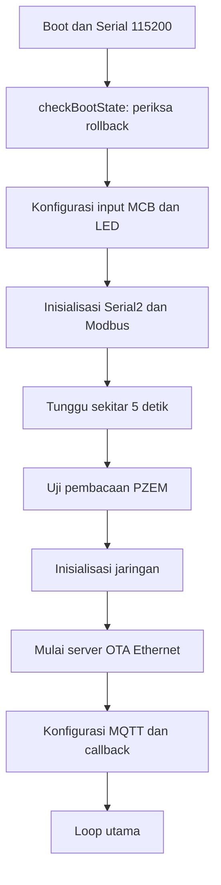

# Build, upload awal, dan alur runtime

[Kembali ke README](../README.md)

## 6. Build dan upload pertama

Gunakan PlatformIO IDE atau PlatformIO Core.

Dependensi:

- `4-20ma/ModbusMaster @ ^2.0.1`
- `bblanchon/ArduinoJson @ ^7.0.4`
- `256dpi/MQTT @ ^2.5.3`
- Library lokal `lib/EthernetSPI2`

Build:

```sh
pio run -e esp32doit-devkit-v1
```

Upload USB:

```sh
pio run -e esp32doit-devkit-v1 -t upload
```

Monitor serial:

```sh
pio device monitor -b 115200
```

Jika diperlukan, tentukan port upload:

```sh
pio run -e esp32doit-devkit-v1 -t upload --upload-port COM5
```

Pada Linux, port dapat berupa `/dev/ttyUSB0`.

Hasil binary aplikasi:

```text
.pio/build/esp32doit-devkit-v1/firmware.bin
```

Post-build script menyalinnya ke:

```text
firmware.bin
```

Pastikan build berhasil sebelum menggunakan binary. File dari build sebelumnya dapat masih tersisa ketika build baru gagal.

Upload USB pertama diperlukan untuk memasang tabel partisi proyek. OTA hanya mengganti aplikasi, bukan tabel partisi.

## 7. Flow boot dan setup



Keterangan:

1. `checkBootState()` memeriksa apakah firmware merupakan hasil OTA yang belum dikonfirmasi.
2. `meter.begin()` mengatur pin RS485 dan serial.
3. Setelah waktu inisialisasi, firmware membaca satu register untuk menguji PZEM.
4. Jika PZEM gagal, setup tetap dilanjutkan.
5. Ethernet mencoba DHCP; jika IP tetap nol setelah masa tunggu tambahan 10 detik, digunakan IP fallback.
6. `Ethernet.begin()` sendiri dapat menunggu, sehingga total startup dapat lebih lama dari 10 detik.
7. Server OTA dimulai pada port TCP 80.
8. Koneksi MQTT dicoba dari loop utama.

## 8. Flow loop utama

Urutan kode:

```text
network.loop()
    ↓
ledManager.loop()
    ↓
otaManager.handleClient()
    ↓
reconnectMQTT() jika belum terhubung
    ↓
client.loop()
    ↓
Jika interval 5 detik:
    baca PZEM
    publish data listrik
    publish data jaringan
    ↓
otaManager.confirmBootIfReady()
```

Timer memakai `millis()`, tetapi seluruh aplikasi belum sepenuhnya nonblocking.

Operasi berikut dapat menahan loop:

- Pembacaan Modbus.
- Percobaan koneksi MQTT.
- Upload firmware HTTP.
- Prosedur reset energi.

Publish tetap dicoba saat jadwalnya tiba walaupun MQTT belum terhubung. Belum ada penyimpanan data offline atau pemeriksaan hasil publish.

### Pengelolaan jaringan

Wi-Fi:

- Mode station.
- Auto-reconnect aktif.
- Reconnect manual setiap 10 detik ketika terputus.

Ethernet:

- MAC lokal dibuat dari sebagian chip ID ESP32.
- DHCP dilakukan saat inisialisasi.
- Status hardware, kabel, dan IP dicetak ke serial.
- Loop saat ini belum memanggil `Ethernet.maintain()` untuk pemeliharaan lease DHCP.
