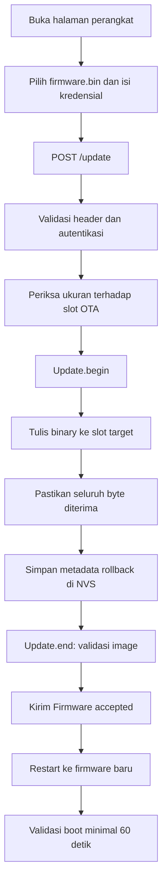

# OTA Ethernet, partisi, dan rollback

[Kembali ke README](../README.md)

## 12. Cara kerja OTA Ethernet

OTA menggunakan HTTP server pada:

```text
http://<ip-esp32>/
```

Server berjalan melalui W5500 pada port TCP 80.

### Endpoint

| Method | Path      | Fungsi                   |
| ------ | --------- | ------------------------ |
| GET    | `/`       | Halaman upload           |
| POST   | `/update` | Menerima binary firmware |

Halaman GET dapat dibuka tanpa login. Autentikasi dilakukan saat upload POST.

### Flow OTA



### Protokol upload

Request harus memiliki:

```text
Authorization: Basic ...
Content-Type: application/octet-stream
Content-Length: ukuran-file
```

Body berisi binary mentah.

Tidak didukung:

- Multipart/form-data.
- Chunked transfer.
- Upload image filesystem.

Form bawaan mengirim file sebagai raw binary menggunakan JavaScript `fetch()`.

Jika upload tidak lengkap atau image tidak valid, kode membatalkan update dan tidak memilih firmware tersebut untuk boot normal berikutnya.

### Langkah upload browser

1. Flash perangkat melalui USB menggunakan tabel partisi proyek.
2. Pastikan mode Ethernet aktif.
3. Lihat IP dari Serial Monitor atau DHCP router.
4. Build firmware baru dan pastikan build berhasil.
5. Buka `http://<ip-perangkat>/`.
6. Isi username dan password OTA.
7. Pilih binary aplikasi `firmware.bin`.
8. Klik Upload firmware.
9. Tunggu pesan `Firmware accepted.` dan restart.
10. Pantau log validasi firmware baru.

Gunakan binary aplikasi dari hasil build proyek, bukan bootloader, tabel partisi, SPIFFS, atau image flash gabungan.

### Upload memakai curl

```sh
curl --fail --show-error \
  --user nama-ota \
  -H 'Content-Type: application/octet-stream' \
  --data-binary @firmware.bin \
  http://192.168.8.159/update
```

Curl akan meminta password.

### Respons HTTP

| Kode | Arti                                                                 |
| ---- | -------------------------------------------------------------------- |
| 200  | Halaman tersedia atau firmware diterima                              |
| 400  | Request tidak valid, upload tidak lengkap, atau image gagal validasi |
| 401  | Autentikasi gagal                                                    |
| 404  | Method/path tidak didukung                                           |
| 413  | Binary melebihi slot OTA atau slot target tidak ditemukan            |
| 431  | Header terlalu besar                                                 |
| 500  | Gagal memulai update atau menyimpan metadata rollback                |

Selama transfer, HTTP ditangani secara sinkron. Pembacaan sensor, LED, MQTT, dan konfirmasi boot dapat tertunda.

HTTP Basic tidak mengenkripsi kredensial atau firmware. Gunakan pada LAN yang dipercaya; jangan expose port 80 ke internet.

Komentar `upload_protocol = espota` di `platformio.ini` bukan mekanisme OTA aktif. Kode terbaru memakai HTTP Ethernet, bukan ArduinoOTA UDP 3232.

## 13. Partisi flash

| Nama      | Jenis       | Offset     | Ukuran               |
| --------- | ----------- | ---------- | -------------------- |
| `nvs`     | data/nvs    | `0x9000`   | `0x5000`, 20 KiB     |
| `otadata` | data/ota    | `0xE000`   | `0x2000`, 8 KiB      |
| `app0`    | app/ota_0   | `0x10000`  | `0x1E0000`, 1920 KiB |
| `app1`    | app/ota_1   | `0x1F0000` | `0x1E0000`, 1920 KiB |
| `spiffs`  | data/spiffs | `0x3D0000` | `0x30000`, 192 KiB   |

Setiap slot aplikasi berukuran 1.966.080 byte.

Firmware berjalan dari satu slot dan menulis update ke slot lainnya. SPIFFS dicadangkan tetapi belum digunakan aplikasi.

Mengubah tabel partisi memerlukan upload melalui USB.

## 14. Cara kerja rollback

Metadata disimpan dalam namespace NVS:

```text
ota-rollback
```

Data yang disimpan:

| Key        | Fungsi                                   |
| ---------- | ---------------------------------------- |
| `target`   | Subtype slot firmware baru               |
| `previous` | Subtype slot sebelumnya                  |
| `started`  | Apakah firmware target pernah mulai boot |
| `pending`  | Apakah validasi masih menunggu           |

### Boot pertama setelah OTA

- `pending=true`.
- Slot berjalan sama dengan `target`.
- `started` diubah menjadi true.
- Timer validasi dimulai.

### Firmware bertahan minimal 60 detik

Saat loop mencapai `confirmBootIfReady()` setelah periode tersebut:

- `pending` dihapus.
- Firmware dianggap lolos validasi.

Log:

```text
[OTA] Firmware passed boot validation
```

Validasi ini tidak mensyaratkan MQTT, Ethernet, atau PZEM berhasil. Waktu dihitung sejak pemeriksaan di awal setup, sehingga durasi setup ikut dihitung.

### Restart sebelum konfirmasi

Jika firmware target boot lagi dengan:

```text
pending=true
started=true
```

kode memilih slot sebelumnya dan restart.

Log:

```text
[OTA] New firmware did not pass boot validation; rolling back
```

Restart manual atau kehilangan daya selama jendela validasi juga dapat memicu rollback.

### Batasan rollback

Mekanisme ini berada pada level aplikasi, bukan jaminan rollback bootloader ESP-IDF.

Firmware baru harus:

- Mempertahankan kode pemeriksaan rollback.
- Mencapai `checkBootState()` pada setup.
- Memanggil konfirmasi boot dari loop.

Crash sebelum pemeriksaan, hang tanpa reset, atau firmware yang menghapus mekanisme tersebut dapat memerlukan pemulihan USB.
